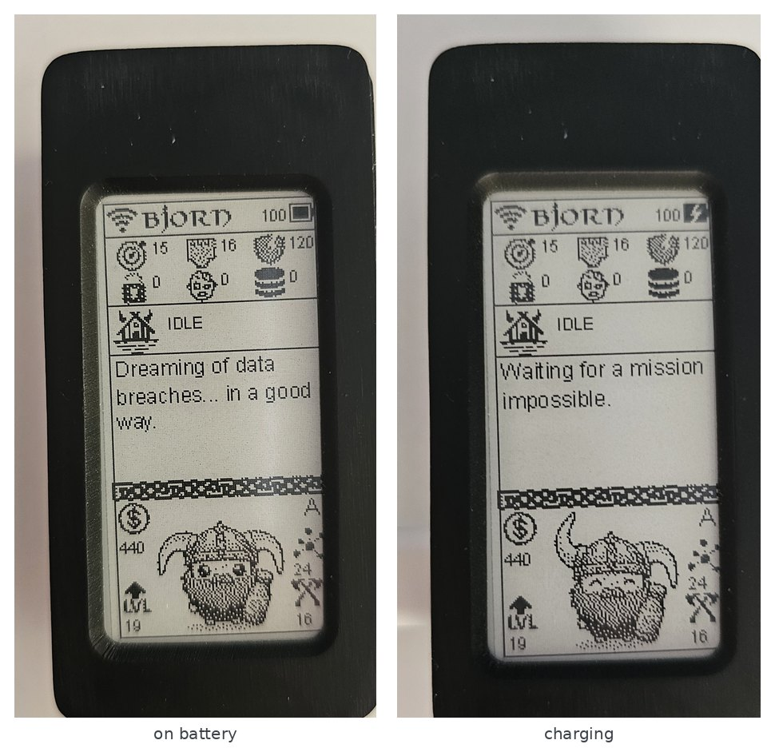
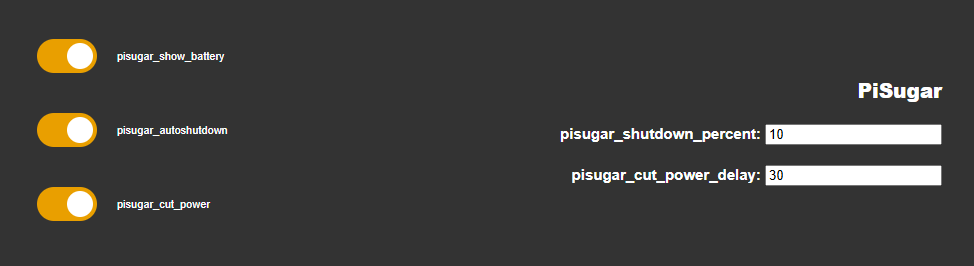

# bjorn-pisugar

PiSugar support for [Bjorn](https://github.com/infinition/Bjorn): battery level on the
e-ink display, automatic shutdown on low battery, and the board cutting its own power
when the Pi halts — all switchable from Bjorn's own web UI.



Bjorn knows nothing about batteries and has no plugin system, so this is a small add-on:
one module dropped next to `Bjorn.py`, a handful of lines patched into `display.py`, and
two systemd units. Nothing is forked and nothing is vendored. The installer records every
change it makes, and the uninstaller reverts exactly those changes, byte for byte.

> A third-party community project. It is not affiliated with, maintained or supported by
> PiSugar or by the Bjorn project.

The PiSugar documentation has a page for this setup: [Bjorn](https://docs.pisugar.com/docs/product-wiki/bjorn/intro).

## What it adds

**Battery indicator.** Percentage and a battery glyph in the top right of the header. The
glyph fills proportionally, and when external power is connected it goes solid with a
lightning bolt knocked out of it. It anchors to the right edge of whatever panel is
fitted. On a narrow 2.13" header there is no free space, so the installer also shifts the
`BJORN` logo from `x=37` to `x=23` and puts the two network icons in one shared slot —
122 pixels will not hold both. Wider panels keep the stock layout.


**Low-battery shutdown.** A systemd timer checks every two minutes and calls
`systemctl poweroff` when the battery is at or below your threshold and unplugged. It
reads twice, ten seconds apart — a fuel gauge can report one bad sample, and a spurious
shutdown mid-scan is worse than one ten seconds late. Deliberately a separate timer
rather than a thread inside Bjorn: if `bjorn.service` dies, the protection has to survive.

**Power cut on halt.** `poweroff` stops the Pi but the PiSugar keeps feeding 5V into
nothing until the battery is flat. A unit hooked to `poweroff.target` starts the PiSugar
3's countdown, and the board switches itself off once the Pi is down. It is wired to
`poweroff.target` and `halt.target` but deliberately **not** `reboot.target`, so a reboot
does not kill the board.

The low-battery shutdown and the power cut are *power control*. Power control is PiSugar 3
only, and it stays off until you name the board — see below.

**Manual shutdown** already exists in stock Bjorn — Playground, the gear dropdown,
*Shutdown*. It runs `shutdown now`, which goes through `poweroff.target`, so with this
add-on installed the PiSugar switches off too. Nothing to add.

## Settings

Bjorn builds its config page straight from `shared_config.json` — booleans become
switches, numbers become fields — so these appear under **Config** with no HTML changes:



| Key | Default | What it does |
|---|---|---|
| `pisugar_show_battery` | `true` | Draw the indicator in the header |
| `pisugar_autoshutdown` | `true` | Enable the low-battery shutdown |
| `pisugar_shutdown_percent` | `10` | Shut down at or below this level |
| `pisugar_cut_power` | `true` | Let the board cut its own power on halt |
| `pisugar_cut_power_delay` | `30` | Countdown before the rail drops, in seconds |
| `pisugar_model` | `auto` | Which board this is: `pisugar3`, `pisugar2`, `pisugar2pro` or `auto` |

**`pisugar_model` decides what is allowed to act.** With `auto`, the board is detected for
the indicator and nothing else happens: no register is ever written and the Pi is never
shut down. Power control needs the board named as `pisugar3`, and even then it checks that
the board answering at `0x57` looks like one — a plausible percentage *and* a plausible
battery voltage — before it touches anything. Detecting an address is not proof of what
is behind it. The installer asks for the model; you can change it here at any time.

Bjorn does not autosave — press the **Save** button in the toolbar (the gold SAVE icon,
second from the left on the second row) or the change is lost on the next page load.
After saving, changes take effect on the next timer tick, with no restart needed for the
guard; the indicator picks up `pisugar_show_battery` and `pisugar_model` on the next
screen refresh.

The guard and the power cut read the config file themselves. If they cannot read it, they
do nothing and log why. They never fall back to the defaults, because both features are
on by default and a wrong path would silently override whatever you switched off.

## Supported hardware

The board is found by probing I2C — `i2c-1` first, then `i2c-0` for very old Pi revisions —
and identified by which address answers and what the registers read back. **The PiSugar
has to be switched on for any of this to work**: if you power the Pi from *its own* USB
port, the PiSugar controller stays off, nothing answers on the bus, and the indicator
simply stays hidden. Press the button on the board.

| Board | `pisugar_model` | Address | Battery level | Charge state | Power control | Status |
|---|---|---|---|---|---|---|
| PiSugar 3 | `pisugar3` | `0x57` | from the controller | yes | yes | ✅ verified |
| PiSugar 3 Plus | `pisugar3` | `0x57` | from the controller | yes | yes | ⬜ untested, same registers |
| PiSugar 2, 2-LED or 4-LED | `pisugar2` | `0x75` (IP5209) | from voltage | — | — | 🧪 experimental |
| PiSugar 2 Pro / 2 Plus | `pisugar2pro` | `0x75` (IP5312) | from voltage | — | — | 🧪 experimental |
| PiSugar 1, PiSugar S / S Plus | — | — | — | — | — | ❌ no I2C, cannot be supported |

**The PiSugar 2 boards are read-only.** They report only a battery voltage, which the
indicator turns into a level with the same curve as the official power manager. Their
charge state is a different story. The 2-LED and 4-LED boards detect external power in
different ways, and reading it needs the chip's GPIOs configured first. That means writing
to it, and none of that has ever been run on real hardware here. So on these boards there
is no charging bolt, no low-battery shutdown and no power cut. Nothing is ever written
to them.

| Panel | Header |
|---|---|
| Waveshare 2.13" V1-V4 (122×250) | logo shifted left, network icons share a slot |
| Waveshare 2.7" (176×264) | stock layout, there is room to spare |

The indicator itself is anchored to the right edge of whatever panel is fitted, so it
lands correctly on either size without being told which one it is. Once `pisugar_model`
names a board, only that board is accepted. A wrong setting finds nothing, rather than
reading another chip's registers as if they were the named board's.

> ### Tested on exactly one machine
>
> Raspberry Pi Zero 2 W · PiSugar 3 · Waveshare 2.13" **V4** · Raspberry Pi OS Bookworm
> **arm64** Lite (`2024-10-22`) · Bjorn `v1.0.0 alpha 2` (upstream `main` at
> [`61a4758`](https://github.com/infinition/Bjorn/commit/61a4758e5ee3d37d43c10eb690340626139912c0)).
>
> Everything else in the tables above is written from the PiSugar datasheets and the
> official power manager's source, and has **never been run on real hardware**. That is
> why the PiSugar 2 boards are read-only and marked experimental.
>
> **[COMPATIBILITY.md](COMPATIBILITY.md)** tracks what is confirmed and what is not. If you
> have a different PiSugar or a different panel, please
> [open an issue](https://github.com/markatsos/bjorn-pisugar/issues) — working or broken,
> both are worth knowing, and the tables get updated from those reports.

## Install

```bash
git clone https://github.com/markatsos/bjorn-pisugar.git
cd bjorn-pisugar
sudo ./install.sh
```

It asks which board you have. To answer up front, or when there is no terminal to ask on:

```bash
sudo ./install.sh --model pisugar3
```

Point it elsewhere if your Bjorn is not in the default location:

```bash
sudo BJORN_DIR=/opt/Bjorn ./install.sh
```

Before changing anything, the installer checks that `display.py` is the Bjorn version it
was written for and that the config file can be read. If either check fails it stops,
with nothing installed. Then it:

- installs `python3-smbus2` and `i2c-tools` if they are missing, and enables I2C if needed;
- copies `pisugar.py` into Bjorn's directory;
- patches `display.py`, keeping the original in `/var/lib/bjorn-pisugar`;
- adds the config keys that are not already there;
- writes and enables the two units, passing them `BJORN_DIR`.

Every change is recorded in `/var/lib/bjorn-pisugar/install.json`: the keys it added, a
SHA-256 of every file it wrote, the packages it installed and whether it enabled I2C. That
record is what the uninstaller works from. Rewritten files keep their owner, group and
mode. Bjorn's directory belongs to the unprivileged `bjorn` user, so the installer, running
as root, never writes through a name there that someone else could have prepared. Each
file goes to a new temporary file with an unpredictable name and is then renamed into
place, and a symbolic link is refused rather than followed. The installer is safe to
re-run. After a Bjorn update that replaced `display.py`,
re-running it patches the new file and keeps the new original.

**Upgrading from 0.2.0:** `git pull` and run `sudo ./install.sh` again. It takes out the
0.2.0 patch, removes the `display.py.stock` that 0.2.0 left behind (if it matches), takes
over the 0.2.0 config keys, and asks for the model. Until the model is set, power control
stays off, so a 0.2.0 install left at `auto` stops shutting down and cutting power after
the upgrade.

## CLI

The module is also usable on its own:

```bash
python3 /home/bjorn/Bjorn/pisugar.py               # board, level, voltage, power control, settings
python3 /home/bjorn/Bjorn/pisugar.py --detect      # which board answers (read-only)
python3 /home/bjorn/Bjorn/pisugar.py --guard 100   # force a guard run, any level counts as low
python3 /home/bjorn/Bjorn/pisugar.py --cut-power 30
python3 /home/bjorn/Bjorn/pisugar.py --cancel      # abort a countdown
```

`--guard 100` is the honest way to test the shutdown path without waiting for the
battery to drain. Unplug first: with external power connected it says so and does
nothing. On battery, it reads again ten seconds later and then shuts down. `--guard`,
`--cut-power` and `--cancel` all need `pisugar_model` set to `pisugar3`, and exit with
status 3 if it is not.

## How it works

Everything goes over I2C. No daemon, no `pisugar-power-manager`, two byte reads every
30 seconds.

**PiSugar 3**, at `0x57`:

| Register | Use |
|---|---|
| `0x2A` | Battery percentage, 0-100 |
| `0x02` bit 7 | External power connected |
| `0x02` bit 5 | Output switch with delay — clearing it starts the countdown |
| `0x09` | Countdown length before the rail drops |
| `0x0B` | Write `0x29` to unlock the other registers, `0x00` to lock |
| `0x22` / `0x23` | Battery voltage in mV, high byte first — part of the identity check |

Two things the datasheet is easy to miss on: the registers are write-protected until you
unlock `0x0B`, and `0x09` has to be written **before** `0x02` is touched or the board
ignores the delay completely. Write protection goes back on in a `finally` block, so an I2C
error halfway through cannot leave the registers unlocked.

**PiSugar 2**, at `0x75` (IP5209): battery voltage from `0xa2`/`0xa3`. **PiSugar 2 Pro /
2 Plus**, at `0x75` (IP5312): battery voltage from `0xd0`/`0xd1`. Nothing else is read
from these chips, and nothing is written. The two are told apart by reading the IP5312
voltage registers first: on an IP5209 they read back as zero, which fails the check, so
it falls through to the IP5209 path.

Note that bit 7 means "there is power at the USB port", not "the battery is filling". At
100% with the cable in, the bolt stays lit. That is usually the thing you actually want
to know.

## Troubleshooting

**Nothing in the header.** Is the PiSugar switched on? `i2cdetect -y 1` should show `57`
for a PiSugar 3 or `75` for a PiSugar 2. Then check `pisugar_show_battery` in Config, and
that `pisugar_model` names the board you actually have (or is `auto`).

**No low-battery shutdown, no power cut.** `pisugar.py` (no arguments) prints a `power:`
line saying why: usually `pisugar_model` is still `auto`. Set it to `pisugar3` in Config.

**The guard never fires.** It refuses while external power is present, by design. Unplug
and test with `--guard 100`.

**A setting will not stick.** `--status` prints what is actually in `shared_config.json`,
so if it still shows the old value the file never changed — almost always a missed
**Save** in the toolbar. Verify with:

```bash
grep pisugar_shutdown_percent /home/bjorn/Bjorn/config/shared_config.json
```

**The Pi shuts down shortly after a reboot.** The poweroff unit fired when it should not
have. Check `systemctl cat pisugar-poweroff.service` — `WantedBy` must not list
`reboot.target`. Cancel the countdown with `--cancel`.

**Is a countdown running right now?**

```bash
i2cget -y 1 0x57 0x02
```

Bit 5 (`0x20`) set means no countdown. `0x6c` and `0xec` are both fine; anything with
bit 5 clear means the rail is about to drop.

**Pasting files over SSH.** A long heredoc over SSH drops lines silently — the terminal
outruns the flow control. If you install by hand rather than with `install.sh`, check
`md5sum` afterwards or send the file with `scp`.

## Uninstall

```bash
sudo ./uninstall.sh
```

It reverts what `/var/lib/bjorn-pisugar/install.json` lists, and nothing else:

- disables and deletes the two units, and removes the module;
- restores `display.py` to the saved original;
- removes the config keys the installer added. Keys that were there before are kept.

If the module, a unit or `display.py` was changed after installation, it stops before
touching anything and names the file. `sudo ./uninstall.sh --force` goes ahead anyway: the
module and the units are deleted, and `display.py` loses only the PiSugar lines, keeping
your other changes.

Packages the installer added, and I2C if it switched that on, are left in place in case
something else now uses them. The uninstaller prints the commands to remove them. A 0.2.0
install, which kept no record, can be removed too: the uninstaller finds Bjorn's directory
from the unit files and removes what 0.2.0 installed.

## Tests

```bash
python3 -m unittest discover -s tests -v
```

They need nothing beyond Python on Linux: no hardware, no `smbus2`, no root. The module is
tested against a simulated I2C bus, and the installer against a throwaway Bjorn tree.

## License

MIT, same as Bjorn. See [LICENSE](LICENSE).

Bjorn is by [infinition](https://github.com/infinition/Bjorn). The PiSugar register map
comes from the [PiSugar 3 I2C datasheet](https://github.com/PiSugar/PiSugar/wiki/PiSugar-3-I2C-Datasheet)
and the official [PiSugar power manager](https://github.com/PiSugar/pisugar-power-manager-rs).
Thanks to the PiSugar team for reviewing the PiSugar 3 integration
([PiSugar/pisugar-doc#4](https://github.com/PiSugar/pisugar-doc/issues/4)). This add-on is
not affiliated with, maintained or supported by either project.
