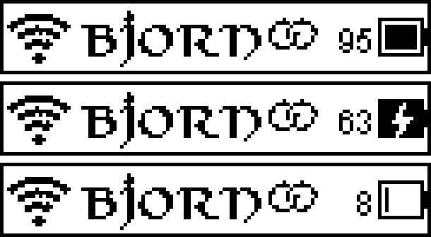

# bjorn-pisugar

PiSugar support for [Bjorn](https://github.com/infinition/Bjorn): battery level on the
e-ink display, automatic shutdown on low battery, and the board cutting its own power
when the Pi halts — all switchable from Bjorn's own web UI.


Bjorn knows nothing about batteries and has no plugin system, so this is a small add-on:
one module dropped next to `Bjorn.py`, a handful of lines patched into `display.py`, and
two systemd units. Nothing is forked and nothing is vendored — an uninstall puts
everything back byte-for-byte.

## What it adds

**Battery indicator.** Percentage and a battery glyph in the top right of the header. The
glyph fills proportionally, and when external power is connected it goes solid with a
lightning bolt knocked out of it. It anchors to the right edge of whatever panel is
fitted. On a narrow 2.13" header there is no free space, so the installer also shifts the
`BJORN` logo from `x=37` to `x=23` and puts the two network icons in one shared slot —
122 pixels will not hold both. Wider panels keep the stock layout.



**Low-battery shutdown.** A systemd timer checks every two minutes and calls
`systemctl poweroff` when the battery is at or below your threshold and unplugged. It
reads twice, ten seconds apart — a fuel gauge can report one bad sample, and a spurious
shutdown mid-scan is worse than one ten seconds late. Deliberately a separate timer
rather than a thread inside Bjorn: if `bjorn.service` dies, the protection has to survive.

**Power cut on halt.** `poweroff` stops the Pi but the PiSugar keeps feeding 5V into
nothing until the battery is flat. A unit hooked to `poweroff.target` tells the board to
switch itself off — a timed countdown on a PiSugar 3, light-load auto shutdown on the
older chips, which comes to the same thing. It is wired to `poweroff.target` and
`halt.target` but deliberately **not** `reboot.target`, so a reboot does not kill the
board.

**Manual shutdown** already exists in stock Bjorn — Playground, the gear dropdown,
*Shutdown*. It runs `shutdown now`, which goes through `poweroff.target`, so with this
add-on installed the PiSugar switches off too. Nothing to add.

## Settings

Bjorn builds its config page straight from `shared_config.json` — booleans become
switches, numbers become fields — so these appear under **Config** with no HTML changes:


| Key | Default | What it does |
|---|---|---|
| `pisugar_show_battery` | `true` | Draw the indicator in the header |
| `pisugar_autoshutdown` | `true` | Enable the low-battery shutdown |
| `pisugar_shutdown_percent` | `10` | Shut down at or below this level |
| `pisugar_cut_power` | `true` | Let the board cut its own power on halt |
| `pisugar_cut_power_delay` | `30` | Countdown before the rail drops |
| `pisugar_model` | `auto` | Override board detection: `3`, `ip5209`, `ip5312` |

Bjorn does not autosave — press the **Save** button in the toolbar (the gold SAVE icon,
second from the left on the second row) or the change is lost on the next page load.
After saving, changes take effect on the next timer tick, with no restart needed for the
guard; the indicator picks up `pisugar_show_battery` on the next screen refresh.

## Supported hardware

The board is found by probing I2C — `i2c-1` first, then `i2c-0` for very old Pi revisions —
and identified by which address answers and what the registers read back. **The PiSugar
has to be switched on for any of this to work**: if you power the Pi from *its own* USB
port, the PiSugar controller stays off, nothing answers on the bus, and the indicator
simply stays hidden. Press the button on the board.

| Board | Detected at | How the level is obtained |
|---|---|---|
| PiSugar 3 / 3 Plus | `0x57` | percentage straight from the chip |
| PiSugar 1 / 2 | `0x75`, IP5209 | voltage, converted with a ten-point curve |
| PiSugar 2 Pro / Plus | `0x75`, IP5312 | voltage, converted with a ten-point curve |

| Panel | Header |
|---|---|
| Waveshare 2.13" V1-V4 (122×250) | logo shifted left, network icons share a slot |
| Waveshare 2.7" (176×264) | stock layout, there is room to spare |

The indicator itself is anchored to the right edge of whatever panel is fitted, so it
lands correctly on either size without being told which one it is. If detection ever picks
wrong, `pisugar_model` in the config overrides it — `3`, `ip5209` or `ip5312`.

> ### Tested on exactly one machine
>
> Raspberry Pi Zero 2 W · PiSugar 3 · Waveshare 2.13" **V4** · Raspberry Pi OS Bookworm
> **arm64** Lite (`2024-10-22`) · Bjorn `v1.0.0 alpha 2` (upstream `main` at
> [`61a4758`](https://github.com/infinition/Bjorn/commit/61a4758e5ee3d37d43c10eb690340626139912c0)).
>
> Everything else in the tables above is written from the PiSugar datasheets and the
> official power manager's source, and has **never been run on real hardware**. It should
> work. Nobody has proved it.
>
> **[COMPATIBILITY.md](COMPATIBILITY.md)** tracks what is confirmed and what is not. If you
> have a different PiSugar or a different panel, please
> [open an issue](https://github.com/markatsos/bjorn-pisugar/issues) — working or broken,
> both are worth knowing, and the tables get updated from those reports.

Two things behave differently on the older boards. The level is derived from voltage
rather than reported by a controller, so expect it to be less steady under load. And they
have no timed power cut — instead the installer arms *light-load auto shutdown*, which
switches the board off about eight seconds after the current draw collapses, which is what
happens when the Pi halts. On those boards `pisugar_cut_power_delay` is ignored.

## Install

```bash
git clone https://github.com/markatsos/bjorn-pisugar.git
cd bjorn-pisugar
sudo ./install.sh
```

Point it elsewhere if your Bjorn is not in the default location:

```bash
sudo BJORN_DIR=/opt/Bjorn ./install.sh
```

The installer is safe to re-run — every step checks whether it has already been done.
It installs `python3-smbus2` and `i2c-tools`, enables I2C if needed, copies the module,
patches `display.py` (keeping the original as `display.py.stock`), adds the config keys,
and enables the two units.

The installer prints what it found — architecture, panel, and which PiSugar answered —
before it changes anything, and warns loudly if it detects a board on the untested path.

## CLI

The module is also usable on its own:

```bash
python3 /home/bjorn/Bjorn/pisugar.py               # level, charge state, current settings
python3 /home/bjorn/Bjorn/pisugar.py --guard 100   # force a guard run, any level counts as low
python3 /home/bjorn/Bjorn/pisugar.py --cut-power 30
python3 /home/bjorn/Bjorn/pisugar.py --cancel      # abort a countdown
```

`--guard 100` is the honest way to test the shutdown path without waiting for the
battery to drain. Unplug first, or it will correctly refuse to act.

## How it works

Everything goes over I2C. No daemon, no `pisugar-power-manager`, two byte reads every
30 seconds.

**PiSugar 3**, at `0x57`:

| Register | Use |
|---|---|
| `0x2A` | Battery percentage, 0-100 |
| `0x02` bit 7 | External power connected |
| `0x02` bit 5 | Output switch with delay — clearing it starts the countdown |
| `0x09` | Countdown length before the rail drops |
| `0x0B` | Write `0x29` to unlock the other registers, `0x00` to lock |

Two things the datasheet is easy to miss on: the registers are write-protected until you
unlock `0x0B`, and `0x09` has to be written **before** `0x02` is touched or the board
ignores the delay completely.

**PiSugar 1 / 2**, at `0x75` (IP5209): voltage from `0xa2`/`0xa3`, external power from
`0x55` bit 4, light-load auto shutdown armed through `0x0c`, `0x04` and `0x02`.

**PiSugar 2 Pro / Plus**, at `0x75` (IP5312): voltage from `0xd0`/`0xd1`, external power
when `0xdd` reads `0x1f`, light-load auto shutdown through `0xc9`, `0x06` and `0x03`.

The two `0x75` chips are told apart by reading the IP5312 voltage registers first: on an
IP5209 they read back as zero, which fails the check, so it falls through to the IP5209
path.

Note that bit 7 means "there is power at the USB port", not "the battery is filling". At
100% with the cable in, the bolt stays lit. That is usually the thing you actually want
to know.

## Troubleshooting

**Nothing in the header.** Is the PiSugar switched on? `i2cdetect -y 1` should show `57`
for a PiSugar 3 or `75` for a 1/2. Then check `pisugar_show_battery` in Config.

**Wrong board detected.** `pisugar.py --status` prints which backend it picked. If it is
wrong, set `pisugar_model` in Config to `3`, `ip5209` or `ip5312` and it will stop
guessing.

**The guard never fires.** It refuses while external power is present, by design. Unplug
and test with `--guard 100`.

**A setting will not stick.** `--status` prints what is actually in `shared_config.json`,
so if it still shows the old value the file never changed — almost always a missed
**Save** in the toolbar. Verify with:

```bash
grep pisugar_shutdown_percent /home/bjorn/Bjorn/config/shared_config.json
```

**The Pi shuts down shortly after a reboot.** The poweroff unit fired when it should not
have. Check `systemctl cat pisugar-poweroff.service` — `WantedBy` must not list
`reboot.target`. Cancel the countdown with `--cancel`.

**Is a countdown running right now?**

```bash
i2cget -y 1 0x57 0x02
```

Bit 5 (`0x20`) set means no countdown. `0x6c` and `0xec` are both fine; anything with
bit 5 clear means the rail is about to drop.

**Pasting files over SSH.** A long heredoc over SSH drops lines silently — the terminal
outruns the flow control. If you install by hand rather than with `install.sh`, check
`md5sum` afterwards or send the file with `scp`.

## Uninstall

```bash
sudo ./uninstall.sh
```

Restores `display.py` from `display.py.stock`, removes the module and the config keys,
disables and deletes the units, restarts Bjorn.

## License

MIT, same as Bjorn. See [LICENSE](LICENSE).

Bjorn is by [infinition](https://github.com/infinition/Bjorn). The PiSugar register map
comes from the [PiSugar 3 I2C datasheet](https://github.com/PiSugar/PiSugar/wiki/PiSugar-3-I2C-Datasheet).
This add-on is not affiliated with either project.
